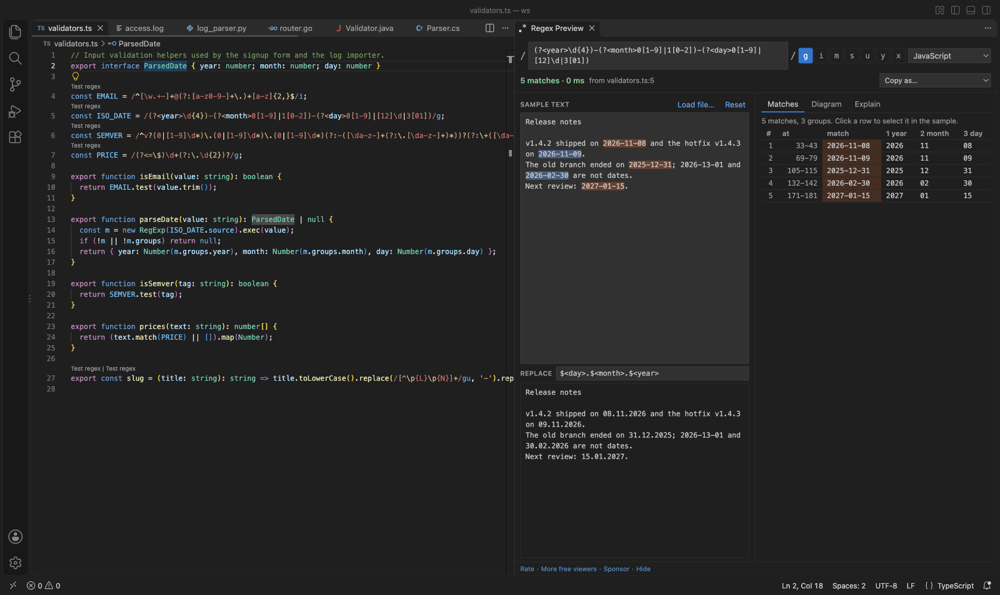
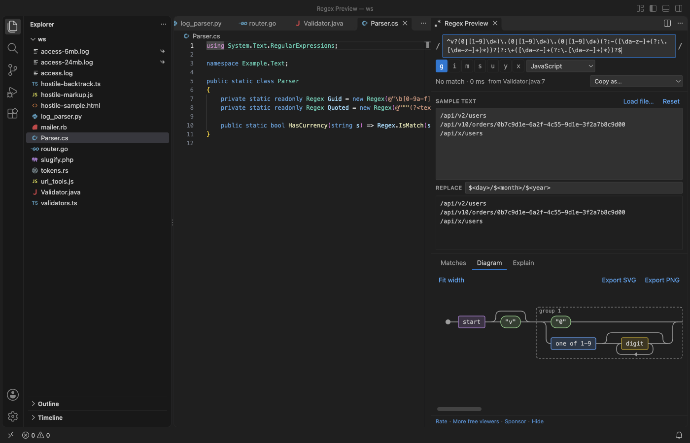
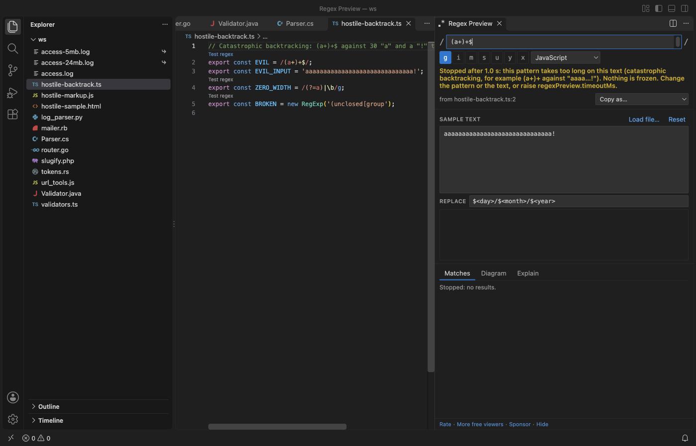

# Regex Preview & Regex Tester (Railroad Diagram Visualizer, Groups)

Click Test regex above a regex in your code and test it on your own text, beside the editor. Every match is highlighted, each numbered and named group gets its own column, and a replace preview, a railroad diagram and a plain-words explanation come with it. Free, no sign-in, works offline: nothing is sent anywhere.

Works in JavaScript, TypeScript, Python, Go, Rust, Java, Kotlin, C#, PHP and Ruby files. In any other file, select a pattern and run Test Selected Text as Regex.

## What it does

- Test regex CodeLens above regex literals and calls such as `re.compile(r"...")`, `regexp.MustCompile(...)`, `Pattern.compile("...")`, `new Regex(@"...")`, `preg_match('/.../')`, `Regex::new(r"...")` and `%r{...}`. String escapes are undone first, so `"\\d+"` in Java is tested as `\d+`.
- Groups for every match: a table with one column per group, numbered and named. A group that did not take part shows a dash. Click a row to select that match in the sample text.
- Your own sample text: type or paste it, and it is kept for the workspace. Load file uses a log or data file instead.
- Replace preview in the flavor's own syntax: `$1` and `$<name>` for JavaScript, `\1` and `\g<name>` for Python, `${name}` for Java, .NET and Go.
- Railroad diagram of the pattern, with groups, lookarounds and repeat counts. Export it as SVG or PNG.
- Explain: one plain line for each part of the pattern.
- Flavors: JavaScript, Python, Java, .NET, Go/Rust (RE2) and PCRE (PHP, Ruby). The panel runs every pattern in JavaScript and lists the syntax that works differently in the chosen flavor, so it does not show a result that would be wrong there without telling you. Examples: possessive quantifiers need Python 3.11, Go has no lookbehind, Python lookbehind must be fixed-width, and Python's `$` also matches before a final newline (the panel does the same).
- Copy as JavaScript, Python, Java, Go, C#, PHP or Rust code.

## Safe on big text and bad patterns

- Each match runs in a background worker with a 1 second limit. A pattern that backtracks without end, such as `(a+)+$` on thirty `a` and a `!`, is stopped after 1 second and the panel says so. VS Code keeps working while it runs.
- A 5 MB log as sample text: 6,509 matches counted in 5 ms in the release check. The table lists the first 1,000 and highlights cover the first 200,000 characters, with a counter for the rest.
- Large files are read only up to 10 MB (setting `regexPreview.maxSampleMB`), with a range read, and the panel tells you how much it used.
- Zero-width patterns such as `\b` or `(?=a)` never loop, and an invalid pattern shows its error and the character where it is.
- Text from your patterns and samples is only ever shown as text. A sample full of `<script>` tags or `onerror=` attributes is matched like any other text and never runs.

## Your language features stay as they are

The link above each regex is a CodeLens and nothing more. There is no language server and no TypeScript plugin, so hover, go to definition and errors in TypeScript, Python and the rest work as before. The release check hovers a TypeScript type and runs go to definition with the extension on.

## How to use it

1. Open a source file and click Test regex above a regex. The panel opens beside the editor with the pattern, its flags and its flavor.
2. Type or paste your text in Sample text, or click Load file.
3. Look at Matches, Diagram and Explain on the right. Type a replacement to see the replaced text.

Cmd+Alt+M (Ctrl+Alt+M on Windows and Linux) opens the panel with the regex on the cursor line, or with the selected text.

## Settings

| Setting | Default | What it does |
|---|---|---|
| `regexPreview.codeLens` | `true` | Show Test regex above regexes |
| `regexPreview.codeLensMaxFileKB` | `1024` | No CodeLens in files larger than this, so big generated files stay fast |
| `regexPreview.timeoutMs` | `1000` | Time limit for one match run |
| `regexPreview.maxSampleMB` | `10` | How much of a file is read as sample text |
| `regexPreview.maxMatchRows` | `1000` | Rows in the match table (all matches are counted) |
| `regexPreview.defaultFlags` | `g` | Flags for a new pattern typed in the panel |
| `regexPreview.askForRating` | `true` | A one-time rating question after you have used it in two sessions |
| `regexPreview.showSupportLinks` | `true` | The small links at the bottom of the panel |

## Privacy

No account, no telemetry, no network. The panel's content security policy blocks every network request, and the release check counts 0 requests from it. The sample text and the last pattern are kept in VS Code's workspace storage on your machine. The only links that leave VS Code are the Rate, Sponsor and Marketplace links, and only when you click them.

## Limits

- Patterns run in VS Code's JavaScript engine. For other flavors the panel rewrites what it can (named groups, `\A`, `\Z`, POSIX classes, `\Q...\E`, verbose mode) and warns about the rest; possessive quantifiers and atomic groups are tested as plain greedy ones.
- In Python, `\d`, `\w` and `\s` also match non-ASCII characters by default; the panel matches ASCII and says so.
- Regexes built at run time from variables are not found by the CodeLens. Select the pattern text and use Test Selected Text as Regex.

Found a pattern that is parsed wrong? Please [open an issue](https://github.com/theluckystrike/regex-preview-vscode/issues) with the pattern and the flavor.

## Support Zovo

Zovo extensions are free, with no ads and no tracking. They are made by [theluckystrike](https://github.com/theluckystrike) on GitHub. If this one saves you time, you can support the work:

- [Sponsor on GitHub](https://github.com/sponsors/theluckystrike)
- [Follow theluckystrike on GitHub](https://github.com/theluckystrike)

## More tools by Zovo

- [Large JSON Viewer, JSON Browser & JSON Tree](https://marketplace.visualstudio.com/items?itemName=zovo.zovo-json-tree-viewer) shows large JSON files as a searchable tree, copies JSONPath and turns arrays of objects into a table.
- [HAR Viewer & HAR File Analyzer (HTTP Archive, Network Log)](https://marketplace.visualstudio.com/items?itemName=zovo.zovo-har-viewer) opens HAR files from browser DevTools with a timing waterfall, filters and a redacted copy for sharing.
- [JSONL Viewer, Large JSONL Table & NDJSON Viewer](https://marketplace.visualstudio.com/items?itemName=zovo.zovo-jsonl-viewer) opens JSONL and NDJSON files as a table, as records or as a chat view.
- [Graphviz Viewer & DOT Viewer (Live Preview)](https://marketplace.visualstudio.com/items?itemName=zovo.zovo-graphviz-preview) shows a live preview of DOT files and exports SVG or PNG.
- [Mermaid Viewer & Mermaid Preview (MMD Diagram, No Sign-In)](https://marketplace.visualstudio.com/items?itemName=zovo.mermaid-viewer) shows Mermaid diagrams from .mmd files and Markdown, with zoom, pan and SVG or PNG export.

See [all Zovo extensions on the Marketplace](https://marketplace.visualstudio.com/publishers/zovo).

## More from zovo

- [All free zovo VS Code extensions](https://marketplace.visualstudio.com/publishers/zovo) — file viewers, database clients, formatters. Offline, no telemetry, no sign-up.
- [Full MCP server catalogue](https://theluckystrike.github.io/mcp/) — local-first MCP servers for back-office work: invoices, VAT, PDFs, spreadsheets, payroll.
- [Hosted no-install MCP endpoints](https://mcp.zovo.one) — paste a URL in Claude / Cursor, nothing to install.
